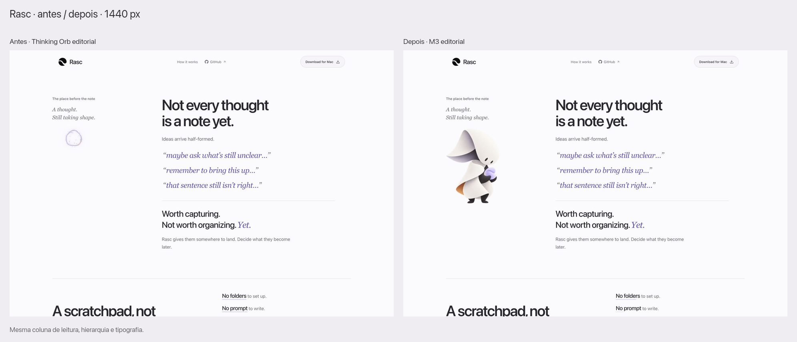
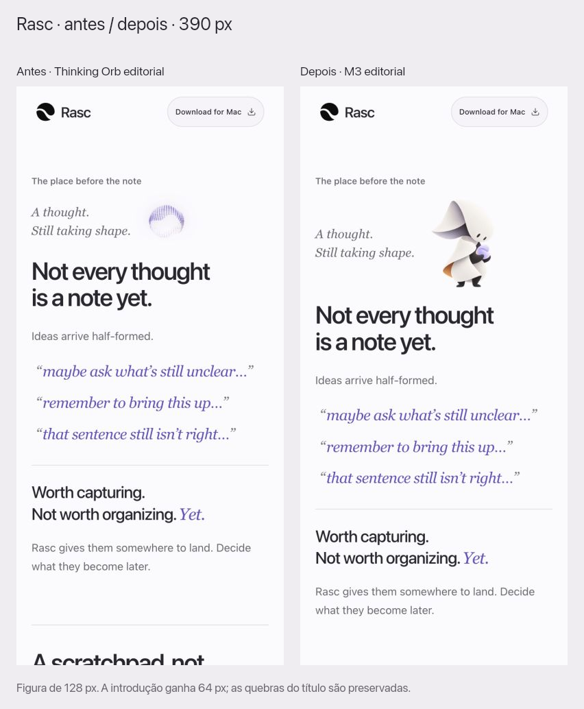
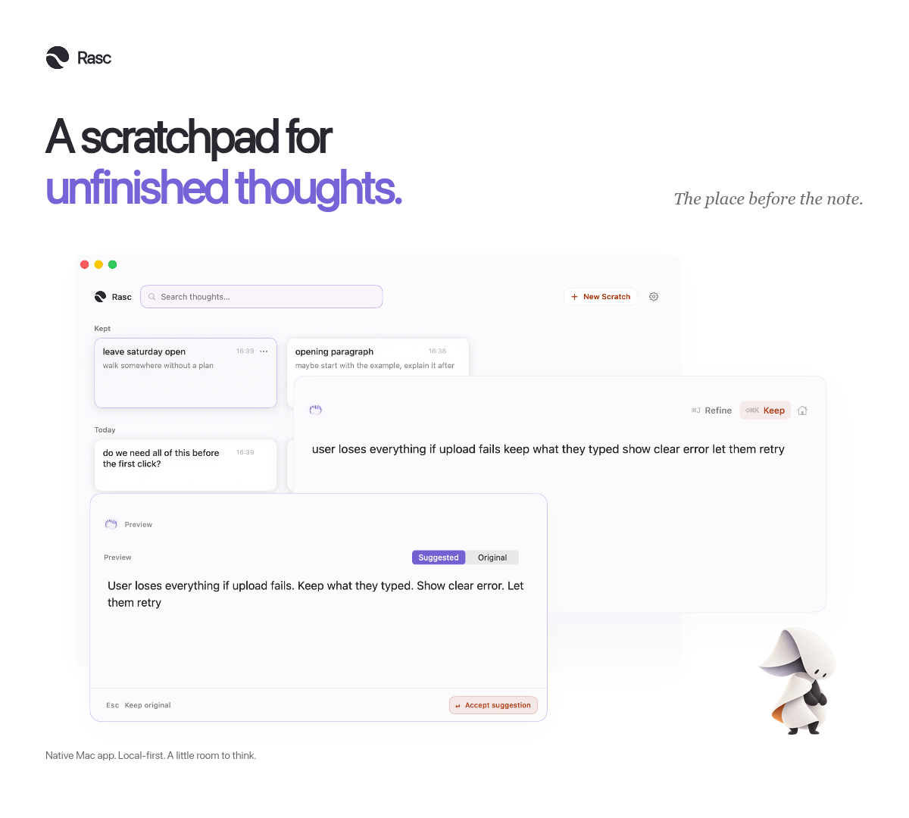

# Companion editorial — implementação para aprovação visual

Branch: `rafa/editorial-companion`. Sem commit, push, merge ou deploy. Uma aplicação de M3 na seção conceitual; hero somente com o produto. App macOS intacto.

## Resultado e avaliação crítica

M3 dá uma interpretação física e afetiva à ideia de acolher um pensamento. A figura permanece subordinada ao título e à coluna de leitura: não alterei copy, largura, tipografia, ordem das seções ou demonstrações. O personagem não é usado como um indicador de IA.

No desktop, a altura visível de 280 px sustenta o lado editorial sem preencher toda a coluna. No mobile, a figura de 128 px divide uma faixa com a frase em Georgia. O custo é explícito: mais 64 px de introdução em relação à Orb anterior. As quebras do título permanecem iguais, e a ilustração não se torna um segundo hero. Recomendo manter esses tamanhos e não repetir o personagem na seção seguinte.

M1 continua convincente como assinatura de uma peça de apresentação do produto. Seu desenho fica fora das janelas, com cerca de 141 px de altura no quadro de 1200 × 1080. O texto interno do app continua pequeno quando a peça é reduzida a um feed; a assinatura acrescenta identidade, não legibilidade funcional. A versão sem personagem permanece canônica.

## Capturas comparativas

Desktop, 1440 × 1000 — mesma seção com o componente anterior e o atual:

Mobile, 390 × 844:

Capturas individuais: [desktop antes](companion-review/desktop-antes.jpg), [desktop depois](companion-review/desktop-depois.jpg), [mobile antes](companion-review/mobile-antes.jpg), [mobile depois](companion-review/mobile-depois.jpg).

Contexto da página real, com o fim do showcase acima da seção: [desktop](companion-review/desktop-contexto.jpg) e [mobile](companion-review/mobile-contexto.jpg).

As comparações são capturas reais do navegador. Os efeitos existentes de entrada/digitação foram assentados no modo de captura, sem modificar os componentes da landing. A Orb anterior usa o componente original de desenvolvimento. As pranchas PNG não aumentam a qualidade dos JPGs de origem e servem para revisão, não para publicação.

## Divulgação

[PNG 1× com M1](showcase/rasc-post-companion.png) e [PNG 2× com M1](showcase/rasc-post-companion@2x.png). O arquivo de publicação é o PNG 2× de 2400 × 2160, composto diretamente dos masters, sem JPEG intermediário.

A imagem canônica e os três captures nativos do app permanecem iguais. Comparei o RGBA do export com o canônico: zero alteração fora do retângulo da assinatura. Os originais e hashes estão no manifesto. Preview local da variante: `/?showcase=post&pose=m1`; original: `/?showcase=post`.

## Verificações executadas

- Build e lint concluídos; `git diff --check` sem problemas.
- Build de produção revisado: somente WebPs de M3 e seu fallback PNG entre os novos assets públicos. M0, M1, masters, família B e páginas de estudo ficam fora do bundle.
- Revisão visual desktop/mobile e medidas no build local em 1440, 1024, 821, 820, 768, 390 e 320 px: sem transbordamento horizontal; uma aplicação editorial; nenhuma ilustração na hero; dois slots de Orb preservados no showcase vivo.
- Imagem carregada em todos os breakpoints registrados, dimensões e fonte selecionada conferidas. As quatro capturas comparativas também tiveram suas dimensões verificadas.
- Teste com atraso de cinco segundos na resposta da imagem: figura e título conservaram exatamente os mesmos retângulos antes/depois do carregamento; CLS total e relativo ao companion foram zero no cenário local observado. O teste usou instrumentação temporária fora do repositório, sem adicionar telemetria à landing.
- Lazy loading, decoding assíncrono, prioridade baixa, alt vazio e caráter decorativo conferidos no DOM. O mascote não tem animação/transição nem item de foco; o estilo computado de animação foi `none`. Nenhum comportamento de movimento do produto foi alterado.
- No teste de produção em DPR 1, o navegador pediu apenas o WebP de 224 px, 13.858 bytes, sem transferir o fallback. Os candidatos de 448/672 px atendem as densidades maiores pelo srcset. Não houve emulação separada de DPR 2/3; os formatos e dimensões foram conferidos no pipeline.
- Masters RGBA idênticos aos recortes originais; contornos revisados sobre claro e grafite. Resolução e alpha dos derivados conferidos; arquivos de origem preservados.
- Fonte macOS sem mudanças e nenhuma alteração nos arquivos do ProductTableau, Thinking Orb ou capturas nativas. Nenhum pacote instalado ou nova dependência de runtime.

A verificação cobre o navegador disponível e as dimensões acima; não é um teste de reconhecimento com usuários nem uma matriz completa de navegadores. A integração aguarda aprovação visual antes de merge/deploy.

## Arquivos da implementação

| Grupo | Arquivos |
| --- | --- |
| Aplicação editorial | `src/page/EditorialCompanion.tsx`, `EditorialCompanion.css`, `EditorialSections.tsx` |
| Web | `src/assets/companion/m3-224.webp`, `m3-448.webp`, `m3-672.webp`, `m3-448.png` |
| Fonte/registro | `brand/companion/m3-master.png`, `m1-master.png`, `m1-web.webp`, `README.md`, `manifest.json` |
| Preview de divulgação | `src/main.tsx`, `src/page/ShowcaseStudy.tsx`, `ShowcaseStudy.css` |
| Estudos locais | `src/page/CompanionStudy.tsx`, `CompanionStudy.css` — M3 usa o componente final, M0/Orb continuam controles, B retirado do estudo ativo |
| PNGs de divulgação | `docs/showcase/rasc-post-companion.png`, `rasc-post-companion@2x.png` |
| Regras/ficha | `docs/EDITORIAL-COMPANION.md`, `brand/README.md`, `manifests/assets.md`, `docs/showcase/README.md` |
| Evidências | Este registro e `docs/companion-review/` |

Os 12 PNGs de exploração já presentes na raiz não foram modificados, movidos ou incluídos no bundle. A ficha define invariantes para futuras aplicações; não acrescenta poses ou transforma os candidatos em uma biblioteca extensa.

## Showcase follow-up: another existing pose

Prepared M3 as a separate publication alternative in response to the small,
disconnected M1 signature. Increased visible height from 141 to 190px and moved
it inward without altering the product. Its violet fragment strengthens the
relationship to the positioning; it adds emotional meaning rather than a
feature explanation. Recommend M3 for expressive publications, retaining M1
for quiet signatures and the product-only composition as canonical.

The new local route is `?showcase=post&pose=m3`. Added two native-source PNG
exports, two comparison boards and a browser proof. The export manifest records
placements, dimensions, hashes and zero pixel changes outside the new signature.
No new landing integration, app change or publication. Build and lint passed.
